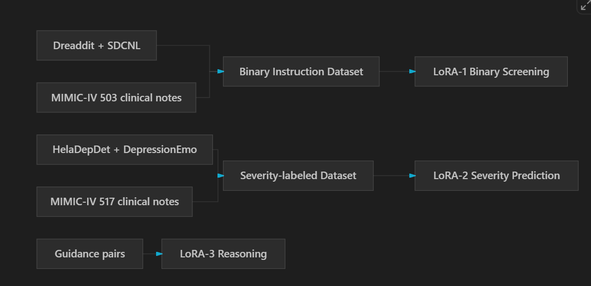

# DepressXLM

Parameter-efficient, multi-LoRA instruction tuning for depression-centric language models.

[](https://github.com/haseebjaved123/DepressXLM_PEFT)
[](https://github.com/haseebjaved123/DepressXLM_PEFT)



## What it is

DepressXLM-PEFT is a manuscript framework that adapts a pretrained language model with three LoRA modules instead of a full fine-tune. This is not a published paper and it has no DOI.

## Why it matters

Depression-related text tools are hard to deploy when every new task requires updating the full model. Separate adapters keep screening, severity, and explanation on different parameter sets.

## Method

The manuscript splits adaptation into three stages:

1. LoRA-1 trains on binary depression-screening instructions.
2. LoRA-2 trains on severity labels.
3. LoRA-3 trains on guidance or explanation pairs.

The framework figure names Dreaddit, SDCNL, HelaDepDet, and DepressionEmo as public text sources, and MIMIC-IV clinical notes as a credentialed source. MIMIC-IV is not included here.

```
python src/lora_stages.py
```

## Citation

```bibtex
@misc{javed2026depressxlm,
  title={DepressXLM-PEFT: Parameter-Efficient Instruction Tuning with Multi-LoRA for a Depression-Centric LLM},
  author={Javed, Haseeb and Oh, Hayoung and Ayadi, Manel and Kwak, Daehan and Ali, Farman},
  year={2026},
  note={Manuscript}
}
```

## License

MIT for this code. Clinical note datasets remain under their own access agreements.
